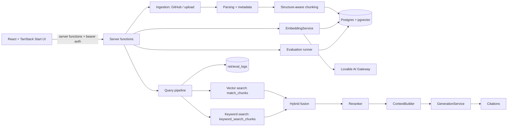

# RAGForge

### Intelligent Technical Knowledge & Debugging Assistant

## Overview
RAGForge indexes GitHub repositories and technical documents (PDF, Markdown, TXT, source code) and answers questions with grounded, cited responses. Every stage of the RAG pipeline is a separate module, and the Retrieval Inspector shows each one for every answer.

## Problem Statement
Generic "chat with your PDF" tools send whole documents to an LLM, hide how retrieval works and make up answers when the evidence is thin. RAGForge does the opposite: it retrieves before it generates, uses both vector and keyword search, reranks, keeps the context small, cites every claim, refuses unsupported answers and measures its own retrieval quality.

## Features
- GitHub, PDF, Markdown, TXT and code ingestion with per-stage progress
- Structure-aware chunking (functions/classes, heading tree, pages/paragraphs) with metadata
- Batched embeddings (`google/gemini-embedding-2`, 3072-d) stored in pgvector (HNSW over `halfvec`)
- Semantic search, Postgres full-text keyword search and weighted hybrid fusion
- Metadata filters: source, language, file type
- LLM listwise reranker, with an honest flag when it did not run
- Context builder: dedupe, relevance threshold, character budget
- Grounded generation (`openai/gpt-6-astra`) with Ask / Debug / Explain modes
- Clickable citations → source viewer with syntax highlighting and highlighted line ranges
- Retrieval Inspector: candidates, scores, rank changes, final context and per-stage latency
- Evaluation: Hit rate, Recall@K, Precision@K, MRR (computed), plus LLM-judged faithfulness, answer relevance and context relevance
- Dashboard and analytics built from stored logs, split into real vs demo data
- Auth (email + Google), row-level security on every table

## Architecture


## RAG Pipeline
| Stage | Module |
| --- | --- |
| Ingestion | `src/lib/sources.functions.ts`, `src/lib/rag/github.server.ts` |
| Parsing | `src/lib/rag/parsing.ts`, `src/lib/pdf-extract.ts` (browser) |
| Chunking | `src/lib/rag/chunking.ts` |
| Embedding | `src/lib/rag/embedding.server.ts` (`embedQuery`, `embedDocument`, `embedBatch`) |
| Retrieval + fusion | `src/lib/rag/retrieval.server.ts` + SQL `match_chunks`, `keyword_search_chunks` |
| Reranking | `src/lib/rag/rerank.server.ts` |
| Context | `src/lib/rag/context.server.ts` |
| Generation | `src/lib/rag/generation.server.ts` |
| Orchestration | `src/lib/rag/pipeline.server.ts`, `src/lib/chat.functions.ts` |
| Evaluation | `src/lib/rag/evaluation.ts`, `src/lib/rag/judge.server.ts`, `src/lib/evaluation.functions.ts` |
| Provider boundary | `src/lib/rag/gateway.server.ts`, `src/lib/rag/config.ts` |

## Tech Stack
React 19, TypeScript (strict), TanStack Start/Router/Query, Vite, Tailwind v4, shadcn/ui, Recharts, Lucide · Lovable Cloud (Postgres, pgvector, Auth) · Lovable AI Gateway.

## Database Schema
`knowledge_sources`, `documents`, `chunks` (vector(3072) + generated `tsvector`), `conversations`, `messages`, `retrieval_logs`, `evaluation_questions`, `evaluation_results`, `profiles`. Every row has `user_id`, and RLS limits access to `auth.uid()`. Indexes: HNSW (`halfvec_cosine_ops`), GIN on `fts`, plus foreign-key and time indexes.

## Retrieval Strategy
1. Embed the query (and record its latency).
2. Run vector search (top-K = 10, cosine) and keyword search (`websearch_to_tsquery` + `ts_rank_cd`, top-K = 10) in parallel, with the same metadata filters.
3. Fuse into ≤ 20 candidates, rerank down to 5, then build the context.

## Hybrid Search
`hybrid = 0.7 × minmax(semantic) + 0.3 × minmax(keyword)`. Normalisation is done per query, so raw `ts_rank` values can never outweigh cosine similarity. A chunk found by only one method gets 0 for the other.

## Reranking
A hosted cross-encoder can't run on this runtime, so the `Reranker` interface is implemented as a listwise LLM scorer (`google/gemini-3.8-flash`) that gives every candidate a score from 0 to 1. If it fails, the hybrid order is kept and `reranker_used=false` is logged and shown. To swap in Cohere/Jina/a cross-encoder, implement `Reranker`.

## Citation System
The context builder numbers the evidence blocks `[1]…[n]`, and the system prompt requires the model to cite them inline. The UI turns markers into chips that open the Source Viewer: the file plus a few lines either side, with the cited range highlighted (code), the page number (PDF) or the heading path (Markdown).

## Evaluation
For each question the real pipeline runs. **Hit / Recall@5 / Precision@5 / MRR** compare the reranked top-5 file paths with the expected sources. **Faithfulness / answer relevance / context relevance** are scored by an LLM judge on the real answer and context, and are labelled as judged. Nothing is hard-coded.

## Local Setup
```bash
bun install
cp .env.example .env   # fill in values
bun run dev
bunx vitest run --dir src            # unit tests
bun ./src/lib/rag/__tests__/e2e.live.ts "How does authentication work?"  # live E2E (needs LOVABLE_API_KEY)
```

## Environment Variables
See `.env.example`. Server secrets are read only inside server handlers and never reach the browser bundle.

## Deployment
Publish from Lovable. Database migrations live in `drizzle/migrations/`.

## Example Queries
- Ask: "How does authentication work?"
- Debug: "Why might login return 401 after deployment?"
- Explain: "Explain how the authentication middleware works."

## Limitations
- GitHub ingestion covers public repos, up to 120 files per source (≤ 180 KB each)
- PDF text is extracted in the browser; scanned PDFs (no text layer) are rejected
- The keyword search uses Postgres FTS (BM25-like), not real BM25
- The reranker is LLM-based, not a cross-encoder

## Future Improvements
Streaming answers, cross-encoder reranker, query rewriting / HyDE, incremental GitHub re-sync via webhooks, chunk-level evaluation labels, a configurable weight UI per query.
